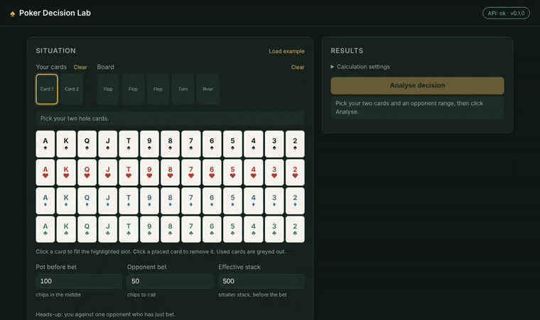
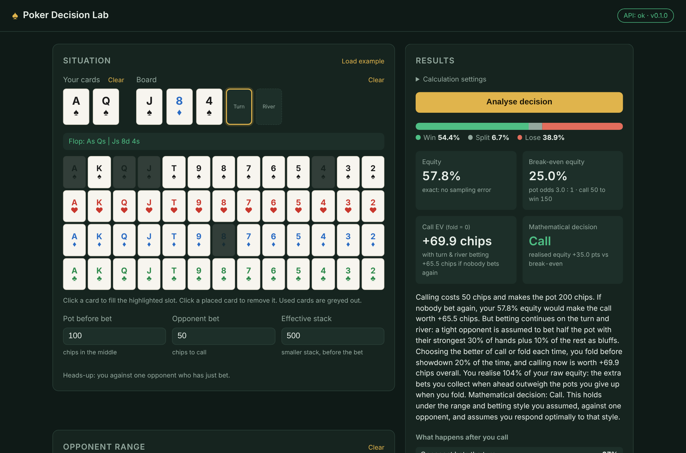

# Poker Decision Lab

[](https://github.com/franabaajo/poker-decision-lab/actions/workflows/ci.yml)

**Facing a bet in Texas Hold'em, should you call or fold?** A decision engine that turns
explicit assumptions about an opponent into win probabilities, pot odds and the expected
value of each choice, with every assumption shown next to the answer.

**[▶ Live demo](https://franabaajo.github.io/poker-decision-lab/)** · runs entirely in your browser, nothing to install
· [Mathematics](docs/math.md) · [Research notebook](notebooks/report.ipynb) · [Design decisions](docs/decisions/README.md)



> **Educational tool, not a gambling aid.** It does not know anyone's cards, does not connect
> to live games and guarantees nothing. Every result is conditional on the assumed opponent
> range and betting style.

## What it does

You enter your two cards, the board, the pot, the opponent's bet, the stacks and a model of
the opponent: **which hands they bet with** (a range, chosen from presets or edited on a
13×13 grid) and **how they keep betting** on the turn and river. The engine then computes:

| Output | How |
|---|---|
| Win / split / lose probabilities and **equity** | Exact enumeration of every opponent hand × every remaining board, or Monte Carlo with a **95% confidence interval** (preflop) |
| **Pot odds** and **break-even equity** | $E^{*} = c / (P + 2c)$ |
| **EV of calling** vs folding, if nobody bets again | $\mathrm{EV} = E\,(P + 2c) - c$ |
| **EV with turn and river betting** | Game tree solved by backward induction, with the opponent's range narrowed by Bayes' rule after each action |
| A **verdict** and a plain-language explanation | Including the assumptions it rests on |



## Highlights

- **Every number is verified, not just computed.**
  - The hand evaluator is checked against all **2,598,960** five-card hands (exact category counts and all 7,462 strength classes), against brute force, against the independent `treys` library and with property-based tests (`hypothesis`).
  - Monte Carlo intervals are tested for **coverage**: about 95% of them really contain the exact answer.
- **Fast by design, proven equal.** The engine was written first as readable pure Python, then **vectorised with NumPy** (6–11× faster). The original is kept as a reference, and tests require identical results.
- **One engine, two runtimes.** The same Python code runs behind a FastAPI server locally and **inside the browser via Pyodide** (WebAssembly) on the live demo, so there is no server to pay for and no cold start. CI checks both.
- **Decisions under uncertainty, stated honestly.** The [research notebook](notebooks/report.ipynb) shows the same hand flipping between *call* and *fold* across plausible opponent models; the app always reports which model it used.
- **Documented engineering.** 26 [decision records](docs/decisions/README.md) explain each choice and its alternatives; the [maths write-up](docs/math.md) derives every formula.

## Research notebook

[`notebooks/report.ipynb`](notebooks/report.ipynb) uses the engine to answer four questions:

1. **Is the simulation trustworthy?** Convergence to the exact answer, and 95% interval coverage over 400 repeated experiments.
2. **How much do the assumptions matter?** One decision under 9 combinations of opponent range and betting style.
3. **Pot odds in practice:** the equity a call needs at each bet size, and which hands have it.
4. **Equity realisation:** strong hands gain from later betting, weak hands lose most of their value.

## How it works

```
Browser UI (HTML/CSS/JS)
   │  same operations, two transports
   ├── HTTP ──► FastAPI (app/main.py) ──┐
   └── Web Worker ──► Pyodide ──────────┤
                                        ▼
                     pokerlab.service  (JSON in / JSON out)
                                        ▼
      cards · evaluator(_fast) · ranges · equity · stats · decision · multistreet
```

| Module | Responsibility |
|---|---|
| [`cards.py`](src/pokerlab/cards.py), [`spot.py`](src/pokerlab/spot.py) | Cards as integers 0–51, parsing, validation of a situation |
| [`evaluator.py`](src/pokerlab/evaluator.py), [`evaluator_fast.py`](src/pokerlab/evaluator_fast.py) | Hand strength as one comparable integer; readable and vectorised versions |
| [`ranges.py`](src/pokerlab/ranges.py), [`profiles.py`](src/pokerlab/profiles.py) | Range notation, weights, card removal; Tight / Balanced / Aggressive presets |
| [`equity.py`](src/pokerlab/equity.py), [`stats.py`](src/pokerlab/stats.py) | Exact and Monte Carlo equity; standard errors and confidence intervals |
| [`decision.py`](src/pokerlab/decision.py) | Pot odds, break-even equity, EV and the showdown verdict |
| [`multistreet.py`](src/pokerlab/multistreet.py) | Turn and river betting: opponent strategy, Bayesian narrowing, backward induction |
| [`service.py`](src/pokerlab/service.py) | The app's operations as JSON functions, shared by FastAPI and the browser |

## Performance

| Task | Reference (pure Python) | Vectorised (NumPy) | Speed-up |
|---|---:|---:|---:|
| Evaluate 200,000 seven-card hands | 1.25 s | 0.112 s | 11× |
| Exact equity, flop, Balanced range | 1.30 s | 0.139 s | 9× |
| Monte Carlo equity, preflop, 50,000 deals | 0.84 s | 0.093 s | 9× |
| Turn + river model, flop, Aggressive | 3.26 s | 0.577 s | 6× |

Measured with `benchmarks/run.py` on a 2-vCPU cloud machine; times vary by machine.

## Run it locally

Requires [uv](https://docs.astral.sh/uv/getting-started/installation/).

```bash
git clone https://github.com/franabaajo/poker-decision-lab.git
cd poker-decision-lab
uv sync
uv run uvicorn app.main:app --reload          # http://127.0.0.1:8000
```

Development:

```bash
uv run pytest -m "not slow"        # quick test run
uv run pytest                      # everything, including exhaustive checks
uv run ruff check . && uv run ruff format --check .
uv run python benchmarks/run.py    # reference vs vectorised timings

# The static, in-browser version (what the live demo serves):
uv run python scripts/build_site.py
uv run python -m http.server 8001 -d site     # http://localhost:8001

# The research notebook:
uv sync --group notebook
uv run jupyter lab notebooks/report.ipynb
```

## Assumptions and limitations

- **Heads-up** (one opponent); the hero only calls or folds, never bets or raises.
- The opponent's range and betting style are **inputs, not knowledge**; results are conditional on them.
- The later-street model uses a simple rule (bet with the strongest and weakest parts of the range) and assumes the hero **responds optimally to it**, which is optimistic against a real, adapting opponent.
- No rake, no multi-hand dynamics.

## Roadmap

- [x] **M0–M1** Project scaffold, CI; cards, validation and card picker
- [x] **M2** Hand evaluator, verified exhaustively
- [x] **M3** Ranges, card removal, presets and range grid
- [x] **M4** Equity: exact enumeration and Monte Carlo with confidence intervals
- [x] **M5** Pot odds, break-even equity, EV and the verdict
- [x] **M6** Turn and river model with Bayesian narrowing and realised equity
- [x] **M7** NumPy vectorisation and benchmarks
- [x] **M8** Maths write-up, research notebook, in-browser engine and live demo

**Planned extensions:** a *raise* option (fold / call / raise), multiway pots, interactive
sensitivity analysis in the app, and board-aware hand strength for the opponent model.

## License

MIT
